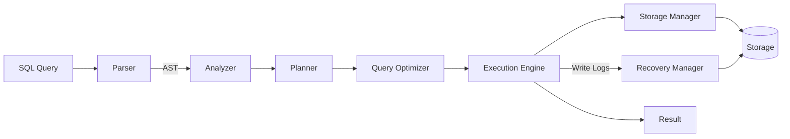

# Database Engine: High-Level Design

A database engine is the part of a database that takes a SQL query, figures out the best way to run it, reads or writes the data, and returns a result. This document explains each component shown in the diagram below.


---

## 1. The Big Picture

A query travels through the engine in stages:




---

## 2. Components

### 2.1 SQL Query (Input)

The raw text sent by the user or application, for example:

```sql
SELECT name FROM users WHERE age > 25;
```

The engine cannot act on plain text, so the first job is to turn it into a structure.

### 2.2 Parser

**What it does:** Reads the SQL text and checks that the **syntax** is correct (keywords in the right order, brackets matched, and so on).

**Output:** An **AST** (see below).

- Catches errors such as `SELEC name FORM users`
- Does **not** check whether the table or column actually exists. That is the Analyzer's job.

### 2.3 AST (Abstract Syntax Tree)

A **tree-shaped representation** of the query. Each node is a part of the query, such as an operation, a table or a condition.

For the query above, the AST looks roughly like this:

```
SELECT
├── columns: [name]
├── FROM: users
└── WHERE
    └── age > 25
```

The AST is easy for the rest of the engine to process, unlike raw text.

### 2.4 Analyzer (Semantic Analysis)

**What it does:** Checks that the query **makes sense**, by asking the Catalog.

- Does the table `users` exist?
- Does the column `name` exist in it?
- Are the data types compatible (is `age > 25` comparing a number to a number)?
- Does the user have permission?

If something is wrong, it returns an error such as `column "nam" does not exist`.

### 2.5 Catalog (System Catalog / Metadata Store)

The database's **own information about itself**. It stores:

- Table and column definitions
- Data types
- Indexes
- Constraints (primary keys, foreign keys)
- Users and permissions
- Statistics (row counts, value distributions) that the optimizer uses

In the diagram the arrow between Catalog and Analyzer points both ways: the Analyzer reads metadata from it, and DDL statements like `CREATE TABLE` update it.

### 2.6 Planner

**What it does:** Converts the validated AST into a **logical query plan**, which is a series of steps (operators) describing *what* needs to happen, such as scan, filter, join, project, sort.

```
Project(name)
   └── Filter(age > 25)
          └── Scan(users)
```

At this point it says *what* to do, not yet *how* to do it most efficiently.

### 2.7 Distribution

This diamond sits between the Planner and the Optimizer and represents the **handoff of the plan** to the next stage.

In **distributed databases** (data spread across several machines or shards), this step decides **which node holds the data** and splits the plan into parts that run on different nodes. In a single-node database it is simply the plan being passed along.

### 2.8 Query Optimizer

**What it does:** Picks the **fastest way** to execute the plan. The same query can often be run in many ways, and the cost can differ by a factor of thousands.

It makes choices like:

| Decision | Example |
|----------|---------|
| Index vs full scan | Use the index on `age` instead of reading every row |
| Join order | Join the small table first |
| Join algorithm | Hash join vs nested loop vs merge join |
| Filter placement | Apply `WHERE` as early as possible to reduce data |

It estimates the **cost** of each candidate plan using statistics from the Catalog and picks the cheapest one. The result is a **physical plan**.

### 2.9 Execution Engine

**What it does:** Actually **runs the physical plan**, step by step.

- Calls the Storage Manager to fetch rows
- Applies filters, joins, sorting and aggregations
- Sends the final rows back as the **Result**
- Sends **write logs** to the Recovery Manager when data is modified (INSERT, UPDATE, DELETE)

Many engines use the **iterator (Volcano) model**, where each operator hands rows to the one above it one at a time.

### 2.10 Storage Manager

**What it does:** Handles **how data is read from and written to disk**. The Execution Engine never touches files directly.

Responsibilities:

- Organizing data into **pages/blocks** (fixed-size chunks, often 4 to 16 KB)
- **Buffer pool / cache**: keeping hot pages in memory so disk reads are avoided
- Managing **indexes** (B-Tree, LSM-tree, etc.)
- Allocating and freeing disk space

### 2.11 Storage

The **physical disk** (or SSD) where tables, indexes and logs live. This is the persistent layer, so data survives restarts.

### 2.12 Recovery Manager

**What it does:** Makes sure the database can **recover after a crash** without losing committed data or keeping half-finished changes.

It works with **Write-Ahead Logging (WAL)**:

1. Before a change is applied to the data files, a log record describing it is written first (the "Write Logs" arrow).
2. If the system crashes, on restart the Recovery Manager **replays** the log to redo committed changes and **undoes** uncommitted ones.

This provides the **Durability** part of ACID.

### 2.13 Transaction Manager

**What it does:** Makes sure groups of operations behave as a single **transaction**, and that concurrent users do not interfere with each other.

- **Begin / Commit / Rollback**
- **Concurrency control**: locks or MVCC (Multi-Version Concurrency Control)
- **Isolation levels** (read committed, repeatable read, serializable)
- Deadlock detection

In the diagram it stands alone because it interacts with *many* components (Execution Engine, Storage Manager, Recovery Manager) rather than sitting in one step of the pipeline.

### 2.14 Result (Output)

The rows (or a success or error message) returned to the client.

---


